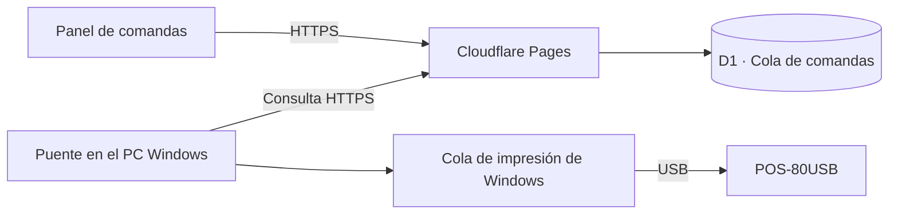

# Punto Cero × La Glotona

Carta pública, editor y panel de comandas para el personal. Desde `/comandas` se accede con el mismo código de propietaria, se seleccionan los productos y se envía la comanda. Un programa en el PC Windows del local recoge el trabajo y lo envía a la POS-80USB conectada por USB. Se puede tomar la comanda desde otro dispositivo, como un móvil o una tableta.



El proyecto usa el código fuente original de Cloudflare Pages. El paquete de Netlify que acompañaba la carta era un proxy de esa instalación. El despliegue de esta versión sobre el proyecto de Pages existente reutiliza la carta guardada, las fotos, el código de propietaria y la dirección que ya usan los QR.

## Tomar comandas y cobrar mesas

- **Mesa.** Selecciona una mesa en el panel y envía la primera comanda. La mesa figura como ocupada mientras tiene una cuenta abierta. Las rondas siguientes mantienen su número de cuenta y cada comanda recibe su número propio. El panel empieza con 14 mesas y permite cambiar la cantidad.
- **Recogida en el bar.** Elige **Para recoger** y añade una referencia, como el nombre de quien recoge el pedido, si la necesitas.
- **Domicilio.** Introduce dirección y teléfono. Elige **La Barca** (2 € de reparto) o **MC** (3 €). Indica si paga con tarjeta, tiene el importe justo o necesita cambio. Si sabes con cuánto pagará, puedes apuntarlo para que salga también el cambio que debe llevarse.
- **Cobro de mesa.** Abre la cuenta de una mesa ocupada. Puedes registrar el importe pendiente completo, dividirlo entre varias personas o introducir el importe de cada cobro. Registra cada parte después de recibir el efectivo o completar el pago en el datáfono. La mesa se libera al liquidar el saldo.

El ticket de cocina incluye el encabezado de La Barca, mesa o tipo de servicio, fecha y hora, números de cuenta y comanda, productos, variantes y notas. Los tickets de domicilio incluyen además los datos de entrega, el importe del reparto y el pago indicado.

## Probar en este ordenador

Requiere Node.js 22 o posterior. Desde PowerShell, en la raíz del proyecto, ejecuta:

```powershell
npm ci
npm test
if (!(Test-Path .dev.vars)) { Copy-Item .dev.vars.example .dev.vars }
npm run dev
```

Abre [el panel local](http://localhost:4173/comandas) y entra con `solo-local-punto-cero`. También puedes abrir [la carta de prueba](http://localhost:4173/carta) y [el editor](http://localhost:4173/admin). La base local usa el catálogo inicial de `src/seed.json`. Los valores de `.dev.vars.example` son públicos y sirven únicamente para esta prueba.

Para simular el formato del ticket en Windows, abre otra terminal en la raíz del proyecto:

```powershell
powershell.exe -NoProfile -ExecutionPolicy RemoteSigned -File .\printer\Print-Comandas.ps1 -DryRun
powershell.exe -NoProfile -ExecutionPolicy RemoteSigned -File .\printer\Print-Comandas.ps1 -DryRun -Scenario Domicilio
```

## Diagnóstico privado

Abre [Diagnóstico en local](http://localhost:4173/logs) o ve a `/logs` en la web desplegada. El único usuario es `LaGlotona` y utiliza una sesión propia. El panel muestra cuántas comandas esperan impresión, la última señal del puente Windows y los eventos de la web, la impresora y el acceso. Filtra por nivel u origen. El resultado muestra hasta 100 eventos de los últimos 30 días. Los eventos usan códigos predefinidos y el número de comanda para identificar el trabajo. Los datos de entrega y las credenciales quedan fuera del registro.

Para configurar o cambiar la contraseña en local, ejecuta el asistente. La terminal la pide en un campo oculto y el asistente guarda el verificador en `.dev.vars`. Reinicia `npm run dev` después de cambiarlo.

```powershell
powershell.exe -NoProfile -ExecutionPolicy RemoteSigned -File .\scripts\Set-LogsPassword.ps1
```

Para configurar el mismo acceso en el proyecto de producción, comprueba primero `DB` y `ADMIN_CODE_HASH` según la sección de despliegue. Inicia sesión con `npx wrangler login`, ejecuta el asistente con `-Cloudflare` y despliega la versión que contiene el panel.

```powershell
powershell.exe -NoProfile -ExecutionPolicy RemoteSigned -File .\scripts\Set-LogsPassword.ps1 -Cloudflare
```

Ese comando guarda `LOG_ADMIN_PASSWORD_HASH` como secreto del proyecto `punto-cero-la-glotona`. Para consultar errores de Pages durante una caída de la base de datos, abre los logs del despliegue en Cloudflare. Para una caída de Internet en el PC de impresión, consulta el registro local del puente. [Logs de Pages](https://developers.cloudflare.com/pages/functions/debugging-and-logging/) · [Guía de la impresora](printer/README.md)

## Actualizar el proyecto existente en Cloudflare

1. En Cloudflare, abre **Workers & Pages → punto-cero-la-glotona**. Comprueba que en producción `DB` sigue apuntando a la base actual y existe el secreto `ADMIN_CODE_HASH`. Anota el nombre de la base y de la rama de producción. Guarda una copia privada de D1 antes de desplegar. [Vínculos y secretos de Pages](https://developers.cloudflare.com/pages/functions/bindings/)

   ```powershell
   npx wrangler login
   New-Item -ItemType Directory -Force copias
   npx wrangler d1 export NOMBRE_DE_LA_BASE --remote --output=./copias/d1-antes-de-comandas.sql
   ```

2. Genera un token nuevo con una fuente aleatoria. Guárdalo para el PC del local y crea un secreto llamado `PRINT_AGENT_TOKEN` en **Settings → Variables and Secrets**. Conserva el `ADMIN_CODE_HASH` existente. [Secretos de Pages](https://developers.cloudflare.com/pages/functions/bindings/#secrets)

   ```powershell
   node -e "console.log(require('node:crypto').randomBytes(32).toString('hex'))"
   ```

3. Si vas a usar el diagnóstico en producción, configura también `LOG_ADMIN_PASSWORD_HASH` con el asistente del apartado anterior. Para probar en una rama de vista previa, configura allí una D1 y secretos de prueba antes de desplegarla. Luego publica en la rama de producción confirmada en el panel. Sustituye `RAMA_DE_PRODUCCION` por su valor. Este repositorio toma los vínculos y secretos de la configuración del proyecto en Cloudflare. [Despliegue de Pages con Wrangler](https://developers.cloudflare.com/pages/get-started/direct-upload/)

   ```powershell
   npm run deploy -- --branch RAMA_DE_PRODUCCION
   ```

   Si el proyecto usa integración Git, incorpora los archivos al repositorio asociado y conserva el proyecto existente con `npm run build` como comando de compilación y `dist` como carpeta de salida. Publica desde la rama de producción configurada. [Integración Git de Pages](https://developers.cloudflare.com/pages/get-started/git-integration/)

4. Comprueba que la carta y las fotos se ven, que tu código sigue funcionando y que el editor muestra **Abrir comandas**. La dirección del panel será [punto-cero-la-glotona.pages.dev/comandas](https://punto-cero-la-glotona.pages.dev/comandas). Las tablas nuevas se preparan al usar el panel o el puente por primera vez.

Si hay que volver a la versión anterior, selecciona el despliegue previo en **Deployments**. Las comandas ya escritas siguen en D1. [Volver a un despliegue anterior](https://developers.cloudflare.com/pages/configuration/rollbacks/)

## Configurar la POS-80USB

1. Conecta la impresora por USB al PC Windows que se usará en el local. Instala el controlador de tu unidad, selecciona papel de 80 mm en la cola correspondiente e imprime una página de prueba de Windows.
2. Guarda el nombre exacto de esa cola y el `PRINT_AGENT_TOKEN` en el PC. Ejecuta la prueba de ticket y deja el puente en marcha siguiendo la [guía de la impresora](printer/README.md).
3. Envía una comanda de prueba desde el móvil. Comprueba el papel, las cantidades, las notas, las tildes y el ancho del ticket. Mantén el PC encendido y el puente en ejecución durante el servicio. El puente inicia la conexión HTTPS con Pages y usa la cola de impresión y el controlador de Windows. [Impresión desde Windows](https://learn.microsoft.com/dotnet/api/system.drawing.printing.printdocument.print)

Si ya tenías el puente de una versión anterior, detén ese proceso y arranca el script actualizado desde la carpeta de esta versión para que los tickets incluyan los datos nuevos.

Si el PC o el programa están apagados, las comandas quedan pendientes en D1. **Enviada a Windows** indica que el puente entregó el ticket a la cola de Windows. Si falta el ticket, revisa papel, conexión USB y la cola de Windows. Reimprime desde el historial solo tras comprobar esos puntos. El ticket adicional llevará la marca **COPIA**. Cuando se pierde la confirmación de un envío, el panel pide revisar la impresión antes de reintentar.

## Archivos

| Ruta | Contenido |
| --- | --- |
| `public/` | Carta, editor, panel de comandas y estilos |
| `src/worker.ts` | Rutas, acceso de propietaria, carta, fotos y QR |
| `src/comandas.ts` | Validación, registro de comandas y cola persistente de impresión |
| `src/comandas-servicio.ts` | Ocupación, reparto y cobros de mesa |
| `src/diagnostico.ts` | Acceso independiente, estado del puente y eventos de diagnóstico |
| `scripts/Set-LogsPassword.ps1` | Configuración de la contraseña de diagnóstico |
| `printer/` | Puente local, configuración de ejemplo y guía de Windows |
| `tests/` | Pruebas de la carta, QR y ciclo de comandas |
| `AGENTS.md`, `memory.md`, `TODO.md` | Guía de trabajo, decisiones y puesta en marcha |
